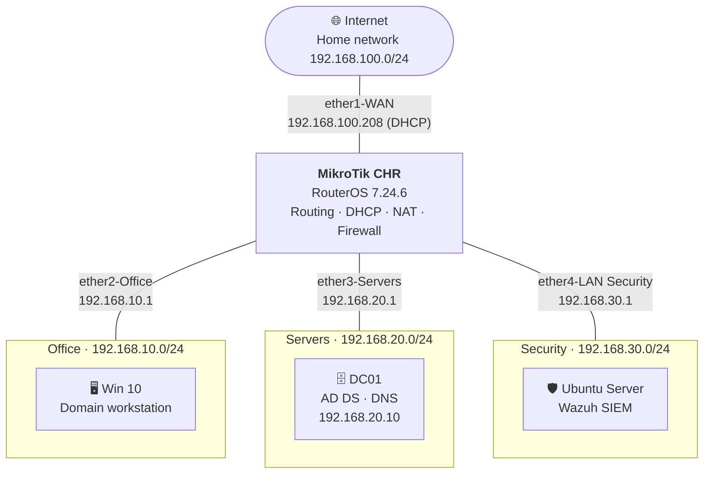

<div align="center">

# Secure Enterprise Network
### MikroTik · Active Directory · Wazuh SIEM


</div>

## Overview

This lab is a small enterprise network built in **Oracle VirtualBox**. It follows standard corporate security practices:

- A **MikroTik Cloud Hosted Router (CHR)** acts as the core router and firewall. It splits the network into three isolated segments: **Office**, **Servers**, and **Security**.
- A **Windows Server domain controller (DC01)** provides centralized identity, authentication, and DNS for the `corp.local` domain.
- A **Wazuh SIEM** on Ubuntu Server collects and correlates security events from the domain hosts and the router.

The goal is to show network segmentation, identity management, and security monitoring working together, the way they would in a small business.

---

## Table of contents

1. [Architecture](#architecture)
2. [Addressing plan](#addressing-plan)
3. [Lab inventory](#lab-inventory)
4. [Implementation status](#implementation-status)
5. [Documentation](#documentation)
6. [Security controls](#security-controls)
7. [Skills demonstrated](#skills-demonstrated)
8. [Repository structure](#repository-structure)

---

## Architecture



Every segment is a separate VirtualBox **internal network** attached to its own router port. Traffic between segments can only go through the MikroTik, where it is routed, translated (NAT), and filtered.

---

## Addressing plan

| Router interface | Segment | Subnet | Gateway | Addressing | Hosts |
|------------------|---------|--------|---------|------------|-------|
| `ether1-WAN` | Internet uplink | 192.168.100.0/24 | Home router | DHCP client (192.168.100.208) | n/a |
| `ether2-Office` | Office / users | 192.168.10.0/24 | 192.168.10.1 | MikroTik DHCP | Win 10 |
| `ether3-Servers` | Servers | 192.168.20.0/24 | 192.168.20.1 | Static, plus MikroTik DHCP | DC01 at 192.168.20.10 |
| `ether4-LAN Security` | Security | 192.168.30.0/24 | 192.168.30.1 | Static | Wazuh server |

**Active Directory**

| Item | Value |
|------|-------|
| Domain (FQDN) | `corp.local` |
| NetBIOS name | `CORP` |
| Domain controller | DC01, 192.168.20.10, Global Catalog |
| DNS forwarders | 8.8.8.8, 8.8.4.4 |
| OU structure | `Departments` → `Finance`, `IT`, `Office` |

---

## Lab inventory

| VM | Operating system | vCPU / RAM | Role | VirtualBox network |
|----|------------------|------------|------|--------------------|
| **MikroTik-CHR** | RouterOS 7.24.6 (long-term) | 1 / 256 MB | Core router, DHCP, NAT, firewall | Adapter 1 Bridged (WAN) · 2 `LAN-Office` · 3 `ether3-Servers` · 4 `LAN-Security` |
| **DC01** | Windows Server (build 26100) | 2 / 2 GB+ | Domain controller, DNS | `ether3-Servers` |
| **Win 10** | Windows 10 (64-bit) | 2 / 2 GB | Domain workstation, Wazuh agent | `LAN-Office` *(see open items)* |
| **Ubuntu Server** | Ubuntu Server | 4 / ~10.6 GB | Wazuh manager, indexer, dashboard | `LAN-Security` *(see open items)* |

---

## Implementation status

| Phase | Component | Status |
|-------|-----------|--------|
| 1 | VirtualBox lab and internal networks | ✅ Done |
| 2 | MikroTik: interfaces and IP addressing | ✅ Done |
| 2 | MikroTik: DHCP server | ✅ Done |
| 2 | MikroTik: NAT (masquerade) | ✅ Done |
| 2 | MikroTik: firewall segmentation rules | ⏳ Planned |
| 2 | MikroTik: hardening and syslog to Wazuh | ⏳ Planned |
| 3 | DC01: static IP, AD DS, DNS, `corp.local` forest | ✅ Done |
| 3 | DC01: OU structure and DNS forwarders | ✅ Done |
| 3 | DC01: users, groups, Group Policy | ⏳ Planned |
| 4 | Win 10 joined to `corp.local` | ⏳ Planned |
| 5 | Wazuh SIEM deployment | ⏳ Planned |
| 6 | Wazuh agents and attack simulation | ⏳ Planned |

### Open items

- [ ] Point the Office DHCP network's DNS to **192.168.20.10** (currently 8.8.8.8). This is required for domain join.
- [ ] Remove the unused `192.168.88.0/24` DHCP network left over from the RouterOS defaults.
- [ ] Move the **Win 10** adapter from *NAT* to internal network `LAN-Office`.
- [ ] Move the **Ubuntu Server** adapter to internal network `LAN-Security`.

---

## Documentation

| # | Guide | Description |
|---|-------|-------------|
| 01 | [VirtualBox lab setup](docs/01-virtualbox-setup.md) | VM sizing and network adapter mapping |
| 02 | [MikroTik configuration](docs/02-mikrotik-configuration.md) | Interfaces, addressing, DHCP, NAT, firewall, hardening |
| 03 | [Active Directory](docs/03-active-directory.md) | DC01 build, `corp.local` forest, OUs, DNS |
| 04 | [Windows client](docs/04-windows-client.md) | Joining Win 10 to the domain |
| 05 | [Wazuh SIEM](docs/05-wazuh-siem.md) | Wazuh all-in-one deployment |
| 06 | [Agents and testing](docs/06-agents-and-testing.md) | Agent rollout and detection test scenarios |

---

## Security controls

| Control | Implementation | Status |
|---------|----------------|--------|
| **Network segmentation** | Three Layer-3 segments on dedicated router interfaces | ✅ |
| **Centralized identity** | Active Directory (`corp.local`) with a department OU structure | ✅ |
| **Controlled DNS** | DC01 is authoritative for the domain and forwards other queries to public resolvers | ✅ |
| **Address translation** | Internal subnets are hidden behind the WAN interface (masquerade) | ✅ |
| **Inter-segment firewall** | Default-deny forward chain; only the AD, DNS, and Wazuh ports are allowed | ⏳ |
| **Router hardening** | Unused services disabled, default `admin` account replaced, management restricted | ⏳ |
| **Group Policy baseline** | Password, lockout, and advanced audit policies | ⏳ |
| **Security monitoring** | Wazuh agents on Windows hosts, plus MikroTik syslog | ⏳ |

---

## Skills demonstrated

- **Networking:** IP subnetting, routing, DHCP, NAT, and firewalling on MikroTik RouterOS 7
- **Systems administration:** Windows Server, AD DS, DNS, OU design, and Group Policy
- **Security operations:** SIEM deployment, log collection, and detection testing with Wazuh
- **Virtualization:** building a multi-segment lab with VirtualBox internal networks

---

## Repository structure

```
Secure-Enterprise-Network/
├── README.md
├── docs/                     Step-by-step implementation guides
├── configs/                  Sanitized configuration exports
└── screenshots/
    ├── virtualbox-vms.png
    ├── mikrotik/             WinBox and console captures
    ├── active-directory/     DC01 configuration captures
    └── wazuh/                SIEM dashboard and alerts
```

---

> **Disclaimer:** this is an isolated lab built for learning. All addresses are private (RFC 1918), and no credentials are included in this repository.
