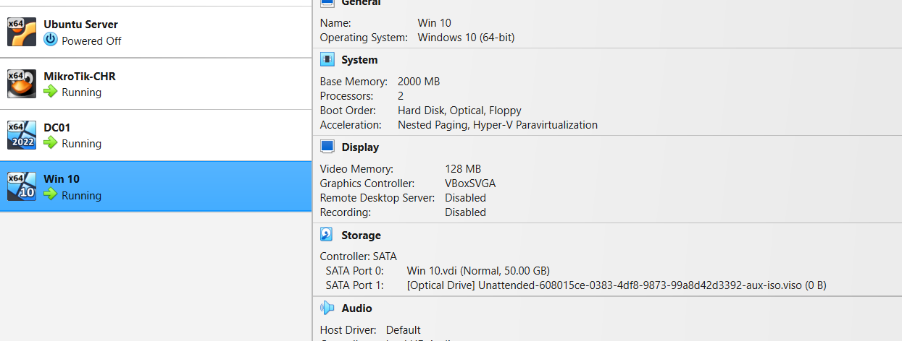

# 1. VirtualBox lab setup

## VMs

| VM | RAM | CPU | Disk | Image |
|----|-----|-----|------|-------|
| MikroTik-CHR | 256 MB | 1 | CHR .vdi | [mikrotik.com/download](https://mikrotik.com/download) → Cloud Hosted Router, VDI image |
| DC01 | 2–4 GB | 2 | 50 GB | Windows Server 2025 evaluation ISO |
| Win 10 | 2 GB | 2 | 50 GB | Windows 10 ISO |
| Ubuntu Server | 8 GB+ (Wazuh needs at least 4 GB) | 4 | 50 GB+ | Ubuntu Server 22.04/24.04 LTS |

## Create the MikroTik CHR VM

1. Download the CHR **VDI** image and extract it.
2. VirtualBox → **New** → Name `MikroTik-CHR`, Type *Linux*, Version *Other Linux (64-bit)*, 256 MB RAM.
3. Choose **Use an existing virtual hard disk file** and select the CHR `.vdi`.
4. **Settings → Network**:
   - Adapter 1: **Bridged Adapter** (your host Wi-Fi/Ethernet). This becomes `ether1` (WAN).
   - Adapter 2: **Internal Network** `LAN-Office` → `ether2` (Office).
   - Adapter 3: **Internal Network** `ether3-Servers` → `ether3` (Servers).
   - Adapter 4: **Internal Network** `LAN-Security` → `ether4` (Security).
5. Start the VM and log in as `admin` with an empty password. RouterOS will make you set a new one.

## Attach the other VMs

Each VM's Adapter 1 must use the **same internal network name** as the MikroTik port that serves its segment. The names are case-sensitive.

| VM | Adapter 1 |
|----|-----------|
| DC01 | Internal Network `ether3-Servers` |
| Win 10 | Internal Network `LAN-Office` |
| Ubuntu Server | Internal Network `LAN-Security` |

   
  <b>Figure 1.1:</b> VirtualBox Manager showing the lab virtual machines: <b>MikroTik-CHR</b>, <b>DC01</b> and <b>Win 10</b> running, and <b>Ubuntu Server</b> powered off. The details pane shows the Win 10 VM with 2 GB RAM, 2 vCPUs and a 50 GB disk.

