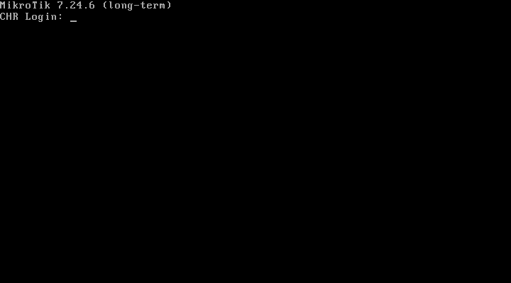
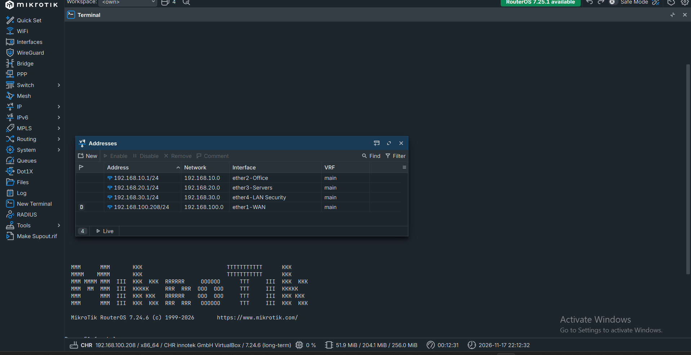
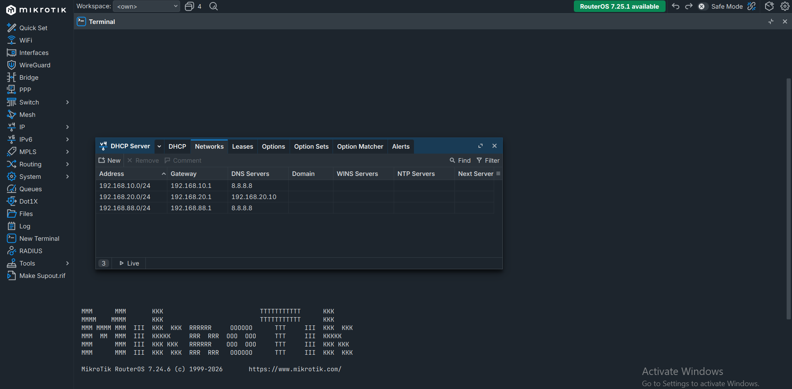
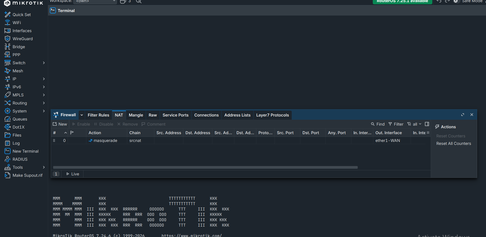

# 2. MikroTik CHR configuration

The MikroTik Cloud Hosted Router (CHR), running **RouterOS 7.24.6 (long-term)**, is the core of the network. It connects the three internal segments, gives clients IP addresses, provides internet access, and enforces security between the segments.

These screenshots were taken from **WinBox** connected to the router.

## 2.1 First boot

After the first boot, the CHR shows a login prompt in the VirtualBox console. The default user is `admin` with an empty password. RouterOS makes you set a new password at the first login.



---

## 2.2 Interfaces and IP addressing

Each router port has a descriptive name and its own subnet. **ether1** gets its address from the home network by DHCP and is the uplink to the internet. The other three ports are the gateways for the internal segments.

| Interface | Address | Network | Purpose |
|-----------|---------|---------|---------|
| `ether1-WAN` | 192.168.100.208/24 (**D** = dynamic, from DHCP) | 192.168.100.0/24 | Uplink to the internet (VirtualBox bridged adapter) |
| `ether2-Office` | 192.168.10.1/24 | 192.168.10.0/24 | Office / user workstations (Win 10) |
| `ether3-Servers` | 192.168.20.1/24 | 192.168.20.0/24 | Server segment (DC01, Active Directory) |
| `ether4-LAN Security` | 192.168.30.1/24 | 192.168.30.0/24 | Security segment (Wazuh SIEM) |

Separating users, servers, and security tools into their own Layer-3 networks is the basis of the segmentation. Traffic between segments has to pass through the router, where the firewall controls it.

**WinBox:** `IP → Addresses`



<details>
<summary>CLI equivalent</summary>

```routeros
/interface ethernet
set ether1 name=ether1-WAN
set ether2 name=ether2-Office
set ether3 name=ether3-Servers
set ether4 name="ether4-LAN Security"

/ip dhcp-client add interface=ether1-WAN disabled=no
/ip address
add address=192.168.10.1/24 interface=ether2-Office
add address=192.168.20.1/24 interface=ether3-Servers
add address=192.168.30.1/24 interface="ether4-LAN Security"
```
</details>

---

## 2.3 DHCP server

The router runs DHCP so that clients get an IP address, a default gateway, and a DNS server automatically.

| Network | Gateway | DNS server | Notes |
|---------|---------|------------|-------|
| 192.168.10.0/24 | 192.168.10.1 | 8.8.8.8 | Office clients |
| 192.168.20.0/24 | 192.168.20.1 | 192.168.20.10 (DC01) | Servers use the domain controller for DNS |
| 192.168.88.0/24 | 192.168.88.1 | 8.8.8.8 | Leftover from the RouterOS default config |

**WinBox:** `IP → DHCP Server → Networks`



> **Why DNS matters for Active Directory:** domain-joined computers find the domain controller through DNS SRV records, which only DC01 has. Office clients must use **192.168.20.10** as their DNS server, or joining the domain will fail. DC01 forwards internet lookups to 8.8.8.8 itself.

<details>
<summary>CLI equivalent</summary>

```routeros
/ip pool
add name=pool-office ranges=192.168.10.100-192.168.10.200
add name=pool-servers ranges=192.168.20.100-192.168.20.200
/ip dhcp-server
add name=dhcp-office interface=ether2-Office address-pool=pool-office disabled=no
add name=dhcp-servers interface=ether3-Servers address-pool=pool-servers disabled=no
/ip dhcp-server network
add address=192.168.10.0/24 gateway=192.168.10.1 dns-server=192.168.20.10
add address=192.168.20.0/24 gateway=192.168.20.1 dns-server=192.168.20.10
```
</details>

---

## 2.4 NAT (internet access)

Internal addresses (192.168.x.x) can't be routed on the internet. A **source NAT masquerade** rule replaces the source address of outgoing packets with the router's WAN address, so every internal segment can reach the internet through one IP.

| # | Chain | Action | Out interface |
|---|-------|--------|---------------|
| 0 | srcnat | masquerade | ether1-WAN |

**WinBox:** `IP → Firewall → NAT`



<details>
<summary>CLI equivalent</summary>

```routeros
/ip firewall nat add chain=srcnat out-interface=ether1-WAN action=masquerade comment="LAN to Internet"
```
</details>

---

## 2.5 Firewall (segmentation), planned

The policy is default-deny between segments. These flows are allowed:

| From | To | Ports | Why |
|------|----|-------|-----|
| Office | DC01 | DNS 53, Kerberos 88/464, LDAP 389/636, SMB 445, RPC 135 + 49152-65535, NTP 123 | Domain logon and GPO |
| Office, Servers | Wazuh | TCP 1514, 1515 | Wazuh agents |
| Router | Wazuh | UDP 514 | Syslog |
| Office | Wazuh | TCP 443 | Dashboard |
| All LANs | WAN | any | Internet |

```routeros
/ip firewall address-list
add list=OFFICE address=192.168.10.0/24
add list=SERVERS address=192.168.20.0/24
add list=SECURITY address=192.168.30.0/24
add list=DC address=192.168.20.10
add list=WAZUH address=192.168.30.10

/ip firewall filter
# --- input (traffic to the router itself) ---
add chain=input connection-state=established,related,untracked action=accept comment="accept est/rel"
add chain=input connection-state=invalid action=drop
add chain=input protocol=icmp action=accept
add chain=input in-interface=!ether1-WAN action=accept comment="mgmt from LAN"
add chain=input action=drop comment="drop all else (WAN)"

# --- forward ---
add chain=forward connection-state=established,related,untracked action=accept
add chain=forward connection-state=invalid action=drop
add chain=forward in-interface=!ether1-WAN out-interface=ether1-WAN action=accept comment="LAN -> Internet"
add chain=forward src-address-list=OFFICE dst-address-list=DC protocol=udp dst-port=53,88,123,389,464 action=accept comment="Office -> DC (udp)"
add chain=forward src-address-list=OFFICE dst-address-list=DC protocol=tcp dst-port=53,88,135,389,445,464,636,3268,49152-65535 action=accept comment="Office -> DC (tcp)"
add chain=forward dst-address-list=WAZUH protocol=tcp dst-port=1514,1515 action=accept comment="Agents -> Wazuh"
add chain=forward src-address-list=OFFICE dst-address-list=WAZUH protocol=tcp dst-port=443 action=accept comment="Wazuh dashboard"
add chain=forward action=drop log=yes log-prefix="FW-DROP" comment="default deny"
```

> ⚠️ WinBox from the host PC connects through `ether1-WAN`. Before you add the "drop all else (WAN)" input rule, first add an accept rule for your PC's IP, or WinBox will disconnect. Enable **Safe Mode** in WinBox while you edit firewall rules: if you lose the connection, the changes are rolled back automatically.

---

## 2.6 Hardening, planned

```routeros
/ip service disable telnet,ftp,www,api,api-ssl
/tool mac-server set allowed-interface-list=none
/ip neighbor discovery-settings set discover-interface-list=!dynamic
/system ntp client set enabled=yes servers=pool.ntp.org
/user add name=netadmin group=full password="<strong-password>"
/user disable admin
```

## 2.7 Send logs to Wazuh, planned

```routeros
/system logging action add name=wazuh target=remote remote=192.168.30.10 remote-port=514
/system logging add topics=firewall action=wazuh
/system logging add topics=account action=wazuh
/system logging add topics=system,info action=wazuh
```
