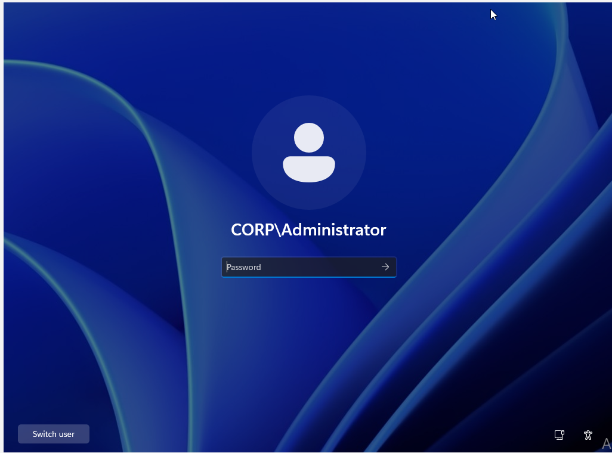
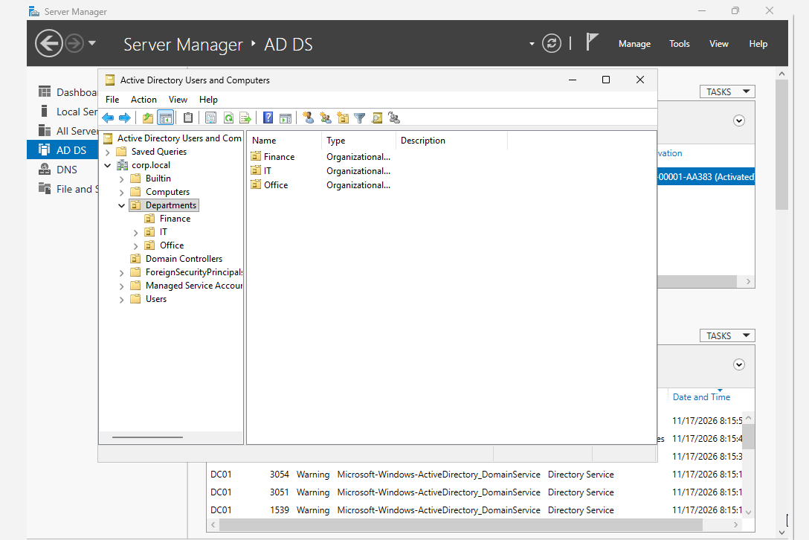
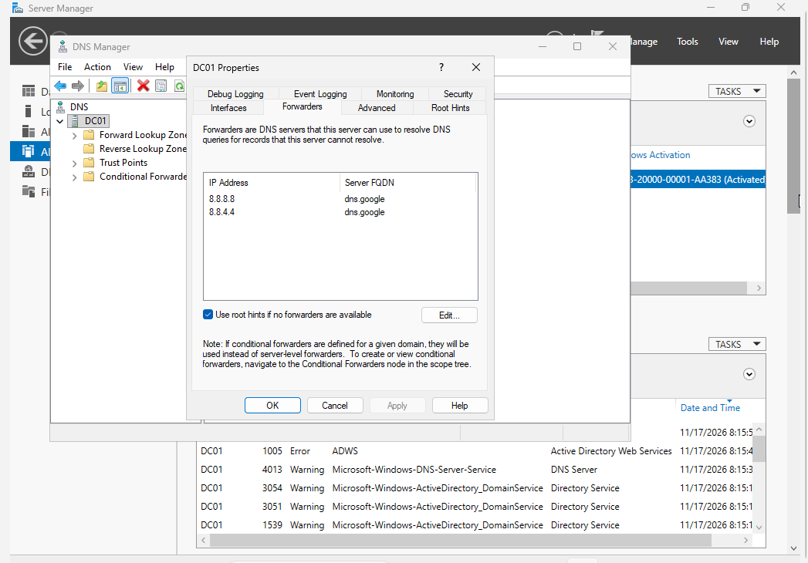
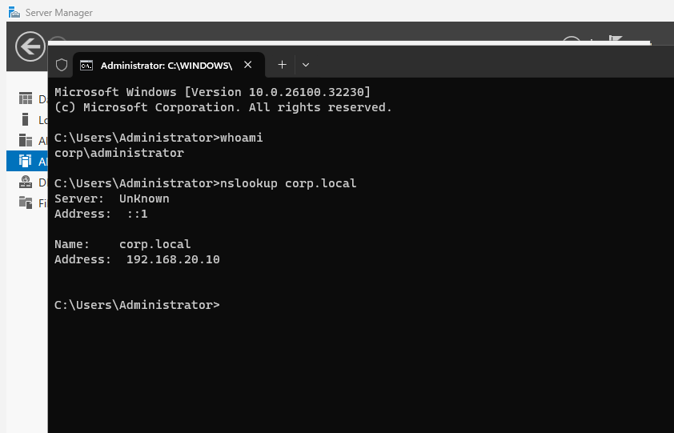
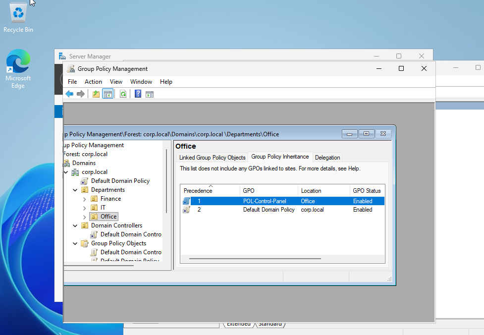
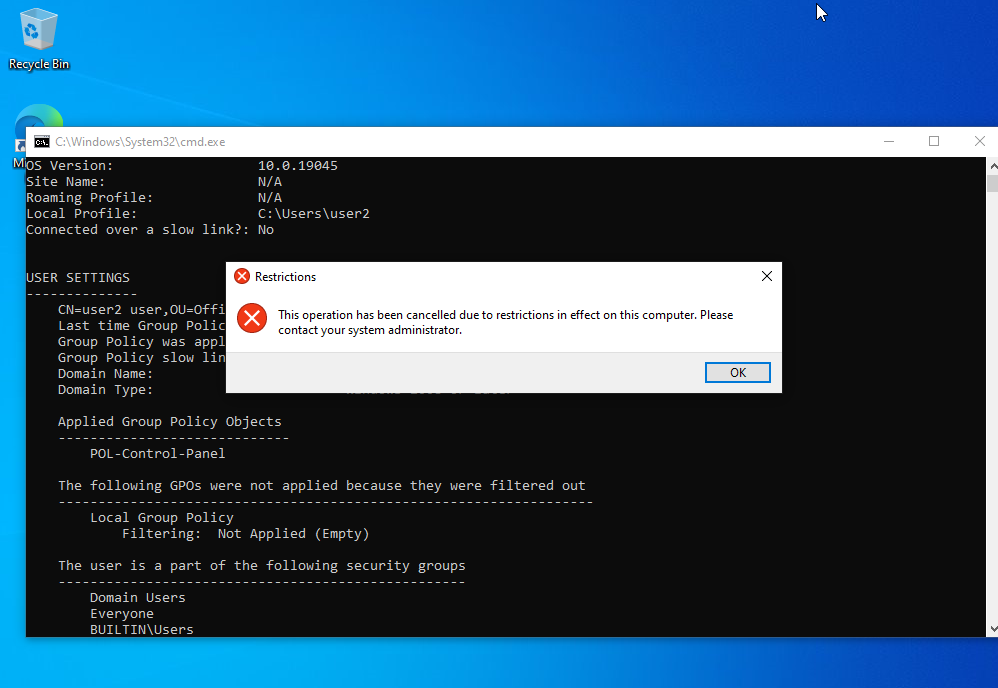

# 3. Active Directory on DC01

**DC01** is the domain controller for the `corp.local` domain. It provides centralized identity (users, computers, groups), authentication (Kerberos), and DNS for the whole network. It sits in the **Servers segment** (`ether3-Servers`, 192.168.20.0/24) behind the MikroTik router.

| Setting | Value |
|---------|-------|
| Hostname | DC01 |
| OS | Windows Server 2025 Standard (build 26100) |
| Domain (FQDN) | `corp.local` |
| NetBIOS name | `CORP` |
| IP address | 192.168.20.10/24 (static) |
| Default gateway | 192.168.20.1 (MikroTik `ether3-Servers`) |
| DNS | 127.0.0.1 / ::1 (itself) |
| Roles | AD DS, DNS, File and Storage Services |

---

## 3.1 Static IP configuration

A domain controller must have a **static IP**. Clients find it through DNS, so its address can't change. DC01 uses the MikroTik as its gateway and **itself** (`127.0.0.1` / `::1`) as its DNS server, because it hosts the `corp.local` DNS zone.

Results of `ipconfig /all`:
- **Host Name:** DC01, **Primary DNS Suffix:** corp.local
- **DHCP Enabled:** No (static)
- **IPv4:** 192.168.20.10, mask 255.255.255.0, gateway 192.168.20.1
- **DNS Servers:** ::1 and 127.0.0.1

<p align="center">
  <br>
  <sub><b>Figure 3.1:</b> <code>ipconfig /all</code> on DC01. DHCP is disabled and the server has the static address <b>192.168.20.10/24</b>, with default gateway <b>192.168.20.1</b> (MikroTik). DNS points to the server itself (<b>::1 / 127.0.0.1</b>), and the primary DNS suffix is <b>corp.local</b>.</sub>
</p>

<details>
<summary>PowerShell equivalent</summary>

```powershell
New-NetIPAddress -InterfaceAlias "Ethernet" -IPAddress 192.168.20.10 -PrefixLength 24 -DefaultGateway 192.168.20.1
Set-DnsClientServerAddress -InterfaceAlias "Ethernet" -ServerAddresses 127.0.0.1
Rename-Computer -NewName DC01 -Restart
```
</details>

---

## 3.2 Installing the AD DS and DNS roles

The **Active Directory Domain Services (AD DS)** and **DNS Server** roles were installed through *Server Manager → Manage → Add Roles and Features*. The server was then promoted to a domain controller by creating a **new forest** named `corp.local`.

The Server Manager dashboard shows the three roles installed: **AD DS**, **DNS**, and **File and Storage Services**. All of them report healthy manageability (green).

<p align="center">
  <br>
  <sub><b>Figure 3.2:</b> The Server Manager dashboard. The <b>AD DS</b>, <b>DNS</b> and <b>File and Storage Services</b> roles are installed, and each reports healthy manageability (green).</sub>
</p>

<details>
<summary>PowerShell equivalent</summary>

```powershell
Install-WindowsFeature AD-Domain-Services, DNS -IncludeManagementTools
Install-ADDSForest -DomainName "corp.local" -DomainNetbiosName "CORP" -InstallDns
```
</details>

---

## 3.3 Logging in as the domain administrator

After promotion, the server reboots. The local Administrator account becomes the **domain administrator**, `CORP\Administrator`, and the logon screen now shows the domain name. This confirms the forest was created.

<p align="center">
  <br>
  <sub><b>Figure 3.3:</b> The Windows logon screen after promotion now shows <b>CORP\Administrator</b>. The local Administrator has become the domain administrator of the new <b>CORP</b> domain.</sub>
</p>

---

## 3.4 Organizational Unit (OU) structure

A **Departments** OU was created with one sub-OU per department. OUs let you link **Group Policy** to specific departments and **delegate administration**. For example, the IT team can manage only the IT OU.

```
corp.local
└── Departments
    ├── Finance
    ├── IT
    └── Office
```

**Tool:** *Server Manager → Tools → Active Directory Users and Computers*

<p align="center">
  <br>
  <sub><b>Figure 3.4:</b> Active Directory Users and Computers showing the <b>corp.local</b> domain. A <b>Departments</b> OU contains the <b>Finance</b>, <b>IT</b> and <b>Office</b> sub-OUs, which are used for Group Policy targeting and delegated administration.</sub>
</p>

<details>
<summary>PowerShell equivalent</summary>

```powershell
New-ADOrganizationalUnit -Name "Departments" -Path "DC=corp,DC=local"
"Finance","IT","Office" | ForEach-Object {
    New-ADOrganizationalUnit -Name $_ -Path "OU=Departments,DC=corp,DC=local"
}
```
</details>

---

## 3.5 Domain Controllers OU

The **Domain Controllers** container lists **DC01**. Its DC Type is **GC (Global Catalog)** and its site is `Default-First-Site-Name`. The Global Catalog holds a searchable copy of every object in the forest. Clients need it for logon and for searching AD.

<p align="center">
  <br>
  <sub><b>Figure 3.5:</b> The <b>Domain Controllers</b> OU lists <b>DC01</b> as a <b>Global Catalog (GC)</b> server in the <i>Default-First-Site-Name</i> site.</sub>
</p>

---

## 3.6 DNS forwarders

DC01 is authoritative only for `corp.local`. Any name it can't resolve itself (for example, `google.com`) is forwarded to **Google DNS (8.8.8.8 and 8.8.4.4)**, with root hints as a fallback.

With this setup, every domain client uses **DC01 as its only DNS server**. Clients can resolve both internal AD records and internet names, and every DNS query goes through the domain controller, where it can be logged.

**Tool:** *DNS Manager → right-click DC01 → Properties → Forwarders*

<p align="center">
  <br>
  <sub><b>Figure 3.6:</b> DNS Manager, <i>DC01 → Properties → Forwarders</i>. Queries that DC01 can't resolve itself are forwarded to Google DNS (<b>8.8.8.8</b> and <b>8.8.4.4</b>), with root hints as a fallback.</sub>
</p>

<details>
<summary>PowerShell equivalent</summary>

```powershell
Add-DnsServerForwarder -IPAddress 8.8.8.8, 8.8.4.4
```
</details>

---

## 3.7 Verification

| Command | Result | Meaning |
|---------|--------|---------|
| `whoami` | `corp\administrator` | Logged in with a domain account |
| `nslookup corp.local` | `192.168.20.10` | The domain name resolves to the DC through its own DNS (`::1`) |

<p align="center">
  <br>
  <sub><b>Figure 3.7:</b> Verification on DC01. <code>whoami</code> returns <b>corp\administrator</b>, and <code>nslookup corp.local</code> resolves to <b>192.168.20.10</b> through the server's own DNS service (::1).</sub>
</p>

Other useful checks:

```powershell
dcdiag /q                      # domain controller health, no output = healthy
Get-ADDomain | Select Name, Forest, DomainMode
nslookup -type=SRV _ldap._tcp.dc._msdcs.corp.local   # SRV record that clients use to find the DC
```

---

## 3.8 Group Policy: restricting Control Panel for Office users

Group Policy is used to enforce a **least-privilege** desktop for standard employees. A GPO named **`POL-Control-Panel`** blocks access to Control Panel and the Settings app, so that Office users can't change system, network, or security settings on their workstations.

| Item | Value |
|------|-------|
| GPO name | `POL-Control-Panel` |
| Linked to | `corp.local → Departments → Office` |
| Setting | *User Configuration → Policies → Administrative Templates → Control Panel → **Prohibit access to Control Panel and PC settings** = Enabled* |
| Scope | User accounts inside the Office OU (for example, `user2`) |
| Status | Enabled |

**Tool:** *Server Manager → Tools → Group Policy Management*

<p align="center">
  <br>
  <sub><b>Figure 3.8:</b> Group Policy Management, <i>Departments → Office → Group Policy Inheritance</i>. <b>POL-Control-Panel</b> is linked to the <b>Office</b> OU with precedence <b>1</b>, above the domain-wide <b>Default Domain Policy</b> (precedence 2). Both GPOs are <b>Enabled</b>.</sub>
</p>

<details>
<summary>PowerShell equivalent</summary>

```powershell
New-GPO -Name "POL-Control-Panel" |
  New-GPLink -Target "OU=Office,OU=Departments,DC=corp,DC=local"

Set-GPRegistryValue -Name "POL-Control-Panel" `
  -Key "HKCU\Software\Microsoft\Windows\CurrentVersion\Policies\Explorer" `
  -ValueName "NoControlPanel" -Type DWord -Value 1
```
</details>

### Verification on the client

On Office-PC, signed in as `CORP\user2`, the policy is refreshed with `gpupdate /force` and checked with `gpresult /r`:

| Check | Result |
|-------|--------|
| User location in AD | `CN=user2 user, OU=Office, ...`, so the user is in scope of the GPO |
| Applied Group Policy Objects | **POL-Control-Panel** |
| Opening Control Panel | Blocked with the *Restrictions* dialog |

<p align="center">
  <br>
  <sub><b>Figure 3.9:</b> Policy enforcement on Office-PC. <code>gpresult /r</code> shows that user2 belongs to the <b>Office</b> OU and has <b>POL-Control-Panel</b> applied. Opening Control Panel now fails with <i>"This operation has been cancelled due to restrictions in effect on this computer."</i></sub>
</p>

```cmd
gpupdate /force
gpresult /r
```

---

## Next steps

- Create security groups per department, and move `OFFICE-PC` into `Departments → Office`.
- Group Policy baseline: password policy (12+ characters), account lockout (5 attempts), and **advanced audit policy** (logon, account management, process creation), so Wazuh receives useful events.
- Join Win 10 to the domain → [04-windows-client.md](04-windows-client.md) ✅
