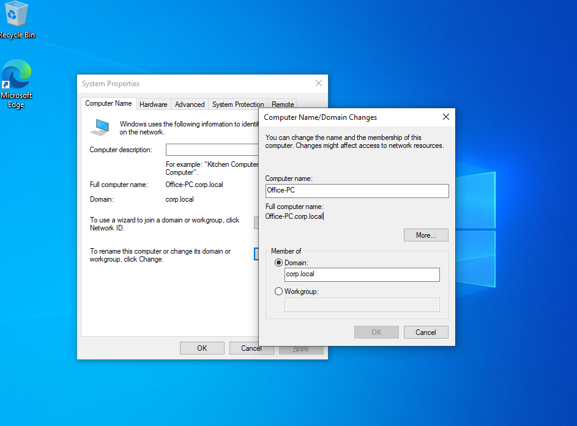
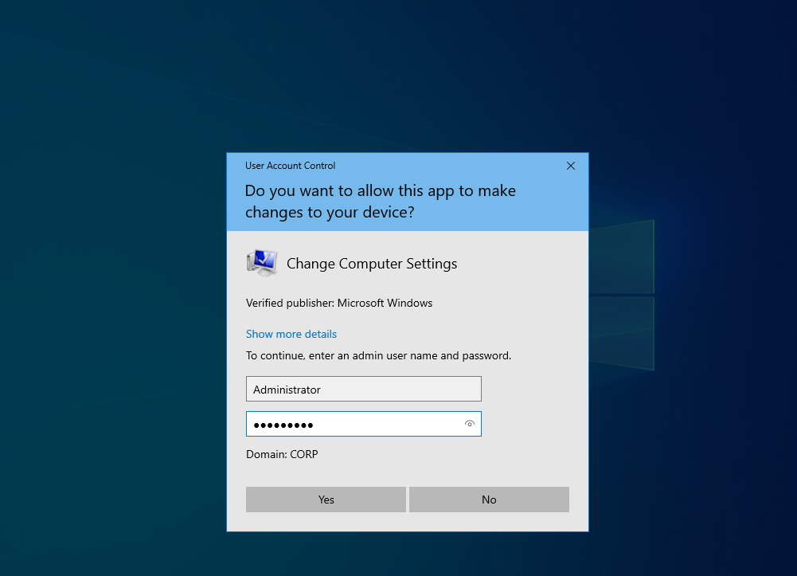
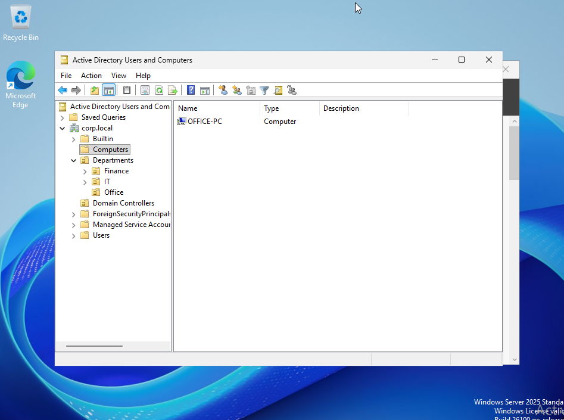
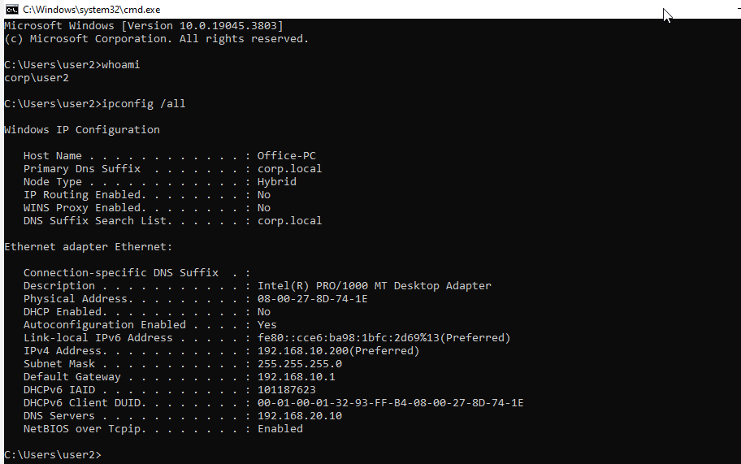

# 4. Joining the Windows 10 client to the domain

> **Status:** ✅ Completed

The **Office-PC** workstation represents an employee computer in the **Office** segment (`ether2-Office`, 192.168.10.0/24). It is joined to the `corp.local` domain, and users sign in to it with their Active Directory accounts, which DC01 authenticates.

| Setting | Value |
|---------|-------|
| Hostname | Office-PC (FQDN `Office-PC.corp.local`) |
| OS | Windows 10 (build 19045) |
| VirtualBox network | Internal Network `LAN-Office` → MikroTik `ether2-Office` |
| IP address | 192.168.10.200/24 (static) |
| Default gateway | 192.168.10.1 (MikroTik) |
| DNS server | 192.168.20.10 (DC01) |
| Domain | `corp.local` |
| Test user | `CORP\user2` |

## Prerequisites

| Requirement | Why |
|-------------|-----|
| VirtualBox adapter on **Internal Network `LAN-Office`** | Connects the VM to `ether2-Office` on the router |
| DNS server set to **192.168.20.10** | Clients find the domain controller through DNS SRV records hosted on DC01 |
| Routing between the Office and Servers segments | Kerberos, LDAP, and SMB traffic reaches DC01 through the MikroTik |
| A domain account with permission to join computers | `CORP\Administrator` was used here |

---

## 4.1 Join the computer to the domain

Open *System Properties → Computer Name → Change*. The computer is renamed to **Office-PC**, and under **Member of** the option **Domain** is selected with the value **`corp.local`**.

<p align="center">
  <br>
  <sub><b>Figure 4.1:</b> <i>System Properties → Computer Name/Domain Changes</i>. The workstation is named <b>Office-PC</b> and set as a member of the <b>corp.local</b> domain, so its full computer name becomes <b>Office-PC.corp.local</b>.</sub>
</p>

<details>
<summary>PowerShell equivalent</summary>

```powershell
Add-Computer -DomainName corp.local -NewName Office-PC -Credential CORP\Administrator -Restart
```
</details>

---

## 4.2 Authenticate with domain credentials

Joining a domain is a privileged operation. Windows asks for credentials of a domain account that is allowed to add computers to the domain. The **Domain: CORP** label confirms that the client reached DC01 through DNS and is authenticating against Active Directory.

<p align="center">
  <br>
  <sub><b>Figure 4.2:</b> The User Account Control prompt asks for domain credentials to <i>Change Computer Settings</i>. <b>Administrator</b> is entered against <b>Domain: CORP</b>. After the computer is added to the domain, it restarts.</sub>
</p>

---

## 4.3 Computer object in Active Directory

When the join succeeds, DC01 creates a **computer account** for the workstation. By default, new computers go into the built-in **Computers** container.

<p align="center">
  <br>
  <sub><b>Figure 4.3:</b> Active Directory Users and Computers on DC01 (Windows Server 2025). The new computer object <b>OFFICE-PC</b> appears in the default <b>corp.local → Computers</b> container.</sub>
</p>

> **Recommended next step:** move `OFFICE-PC` into `Departments → Office` so that Office-specific Group Policies apply to it. The default `Computers` container is not an OU, so GPOs can't be linked to it.
>
> ```powershell
> Get-ADComputer OFFICE-PC | Move-ADObject -TargetPath "OU=Office,OU=Departments,DC=corp,DC=local"
> ```

---

## 4.4 Verification: domain user logon

After the restart, a domain user signs in to the workstation.

| Check | Result | Meaning |
|-------|--------|---------|
| `whoami` | `corp\user2` | Logged on with an Active Directory account, not a local one |
| Host Name / Primary DNS Suffix | `Office-PC` / `corp.local` | The machine is a domain member |
| IPv4 / Gateway | 192.168.10.200 / 192.168.10.1 | Located in the Office segment behind the MikroTik |
| DNS Servers | 192.168.20.10 | Resolves through the domain controller in the Servers segment |

<p align="center">
  <br>
  <sub><b>Figure 4.4:</b> Verification on Office-PC. <code>whoami</code> returns <b>corp\user2</b>. <code>ipconfig /all</code> shows host <b>Office-PC</b> in domain <b>corp.local</b>, IP <b>192.168.10.200</b>, gateway <b>192.168.10.1</b> and DNS server <b>192.168.20.10</b> (DC01). This proves that cross-segment authentication through the MikroTik router works.</sub>
</p>

Additional checks:

```cmd
nltest /dsgetdc:corp.local      :: shows which DC the client uses
gpresult /r                     :: shows the applied Group Policies
```
